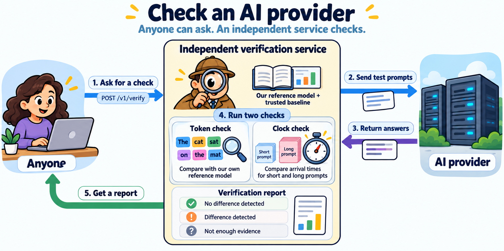

# Inference Verification · IVGym

**Is your LLM provider serving the model and settings it claims?**

IVGym checks inference behavior using **returned tokens and their timing**.
It combines an independent verification API with a research testbed for measuring
which provider deviations can be detected, how much evidence they require, and
what verification costs.

[](https://github.com/lijiawei20161002/inference-verification/actions/workflows/tests.yml)

[](paper/paper.pdf)

[Try the demo](#try-it-without-a-gpu) · [Run the API](#run-the-verification-api) ·
[Documentation](docs/README.md) · [Research & results](docs/RESEARCH_GUIDE.md) ·
[Contribute](CONTRIBUTING.md)



**Research preview.** Results are statistical evidence about behavior. They do
not certify model identity or hardware. Without matching trusted calibration,
the API returns `inconclusive`.

## What you can do

| Goal | What IVGym provides |
|---|---|
| Check a provider's outputs | Token scores from an independently operated reference model; live streaming `/completions` or submitted captures |
| Investigate context truncation | A clock verifier that compares short- and long-context timing; replay captured intervals without a GPU |
| Study detection tradeoffs | Pluggable attacks and verifiers, audit budgets, and checks against inflated evaluation results |
| Inspect the evidence | Committed run artifacts, real API request/response pairs, and a paper with reproduction scripts |

## Try it without a GPU

Requires Python 3.10+. From a terminal:

```sh
git clone https://github.com/lijiawei20161002/inference-verification.git
cd inference-verification
python3 -m venv .venv
source .venv/bin/activate
python -m pip install -e .
python examples/quickstart.py
```

On Windows, activate with `.venv\Scripts\Activate.ps1` in PowerShell.

The demo uses NumPy and **replays committed measurements** from Qwen3-1.7B on an
H100. It needs no API key, model download, or GPU. Expected output:

```text
IVGym | replay recorded H100 timing evidence
Model: Qwen/Qwen3-1.7B | claimed context: 32768 tokens
64 paired intervals per condition; device timings, not network arrivals.

condition              long - short (ms)     clock score
honest full context               53.631         -53.631
512-token window                   0.366          -0.366

A smaller timing gap raises the anomaly score.
Scores only: no calibrated verdict or live provider check in this demo.
```

[Read the demo](examples/quickstart.py) ·
[Inspect the source measurements](docs/results/slope_verifier_window.json) ·
[Understand the clock verifier](docs/CLOCK_MEASURED.md)

## Run the verification API

You can also try the HTTP API locally without a GPU. In the same environment:

```sh
python -m pip install -e '.[service]'
ivgym serve --port 8000
```

In another terminal, from the repository root:

```sh
curl http://127.0.0.1:8000/v1/verify \
  -H 'Content-Type: application/json' \
  --data-binary @examples/verify-clock.json
```

Open [localhost:8000/docs](http://127.0.0.1:8000/docs) for interactive API docs.
This illustrative capture returns a clock score near `-53.6` and an
`inconclusive` outcome because no calibration has been installed.

For **token checks and live provider probes**, configure a local reference
checkpoint, CUDA, an allowed provider URL, and trusted calibration. Follow the
[service setup guide](docs/VERIFICATION_SERVICE.md#configure-a-reference-model-for-token-and-live-checks).
The service currently supports streaming **`/completions`**, with raw prompts.

| Check | Evidence required |
|---|---|
| `cross_entropy`, `token_toploc` | Returned token IDs or reconstructed text, plus reference-model recomputation |
| `token_difr` | Exact token IDs, reference recomputation, and the original shared RNG contract |
| `clock_slope` | Paired short/long timing observations with matching units and provenance |

[Five real request/response examples](examples/api-samples/README.md) ·
[API reference and calibration](docs/VERIFICATION_SERVICE.md) ·
[Signed-artifact experiment](docs/AUDIT_IMPLEMENTATION.md)

## What the experiments show

| Finding | Evidence and scope |
|---|---|
| The API detected a temperature override | The H100 integration check accepted its honest control and flagged sampling at temperature 2 while claiming 1. [Report](docs/results/verification_service_h100.md) |
| Timing exposes a context-window difference | Replaying 64 paired intervals gives long-minus-short gaps of 53.631 ms for full context and 0.366 ms for a 512-token window. These are device traces. [Measurements](docs/results/slope_verifier_window.json) |
| Real quantization remains difficult | The separate signed-artifact pilot flagged **0/10** real NF4 blocks at its tested budget. [Pilot and limitations](docs/results/audit_protocol_h100.md) |
| Evaluation design can dominate the result | The same detector's reported AUC changed from 0.977 to 0.530 when the token pool grew. The harness checks the batch/pool ratio. [Protocol](docs/RESEARCH_GUIDE.md#the-evaluation-protocol) |

Most research-harness quantization attacks simulate logit perturbations; they
are distinct from real quantized-weight experiments. The measured record is
primarily from one H100. Cross-hardware calibration and deployment false-positive
rates remain open. See the [full limitations](docs/RESEARCH_GUIDE.md#limitations).

## Explore or extend

| I want to… | Start here |
|---|---|
| Understand the project | [Documentation map](docs/README.md) |
| Run an example | [Examples by requirement](examples/README.md) |
| Add an attack or detector | [Extension guide](docs/EXTENDING.md) |
| Reproduce a result | [Experiment map](experiments/README.md) and [claim-to-artifact index](docs/RESEARCH_GUIDE.md#which-experiment-backs-which-claim) |
| Read the research | [Paper](paper/paper.pdf), [one-page poster](paper/mats_poster.pdf), [detailed guide](docs/RESEARCH_GUIDE.md) |
| Continue the numerical diagnosis study | [English next-step plan](planning/NEXT_EXPERIMENTS.md), [CPU diagnostic tools](experiments/numerical/README.md) |
| Help with an open problem | [Roadmap](ROADMAP.md) and [contributing guide](CONTRIBUTING.md) |

```text
ivgym/        Python library, verification API, and optional audit protocol
examples/     Laptop demo, API requests, and custom strategies
experiments/  GPU experiments and figure-generation scripts
docs/         Guides, figures, and committed measurement artifacts
tests/        Core, API, protocol, and research-claim checks
paper/        Paper, posters, and reproduction scripts
```

## Contribute and cite

Contributions that make verification easier to reproduce are especially useful:
clearer examples, provider adapters, and measurements on other hardware. The
[contributing guide](CONTRIBUTING.md) includes setup and scoped starting points.

If you use IVGym in research, cite this repository using
[CITATION.cff](CITATION.cff), and record the commit and artifacts you used.

If this is useful to your work, **star the repo** to help others find it.
