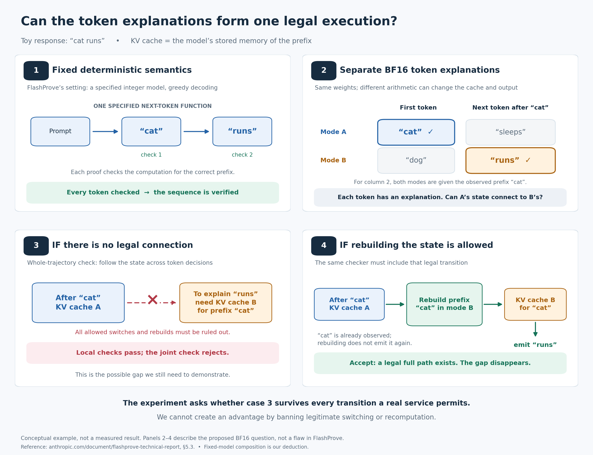

# Whole trajectory verification under realistic execution contracts

**Experimental plan, 12 November 2026. Status: proposed; no trajectory verifier
or new measurements are reported here.**

[Work queue](../planning/NEXT_EXPERIMENTS.md) ·
[Numerical diagnosis study](NUMERICAL_CAUSAL_DIAGNOSIS_EXPERIMENTS.md) ·
[Research directions](../planning/NON_COST_RESEARCH_DIRECTIONS.md) ·
[Message draft](../planning/TRAJECTORY_VERIFICATION_MESSAGE.md)

Determine whether enforcing a single legal state evolution detects incompatible
inference transcripts that strong token checks accept, while accepting all
switching, cache transfer, and recomputation allowed by the serving contract.
The first milestone must establish whether such a gap can exist under the
chosen contract. A finding that legal recomputation closes the gap is a useful
result and stops the corresponding detector claim.



Conceptual example: a joint gap requires excluding every legal connection
between the relevant states. Allowed reconstruction can remove the gap.
[Editable figure](figures/fig_trajectory_consistency_explainer.svg) ·
[Figure source](../experiments/plot_trajectory_consistency_explainer.py)

## 1 Comparison with FlashProve

Anthropic's FlashProve proves that checked tokens are the committed integer
model's greedy choices. Its proof constrains intermediate operations and expert
selection; the token claim is backed by a computation trace.
[Technical report, section 5.3](https://www.anthropic.com/document/flashprove-technical-report#page=12).
The released system explicitly limits its claim to an integer model with greedy
decoding, and discusses disagreement with floating-point or sampled outputs.
[Release limitations](https://www.anthropic.com/research/provable-inference#limitations).

Our deduction from that relation: for a deterministic next-token function
`G_W`, checking `y_t = G_W(x, y_<t)` at every generated position, with the same
weights, specified tie handling, and correctly bound full prefixes, establishes
the entire greedy continuation by induction. Proofs covering selected positions
establish only those positions. Sequence coverage alone is not a new guarantee.

The proposed extension studies a family of allowed floating-point executions
whose internal states can differ for the same token prefix. Its candidate
contribution is a justified joint constraint under those semantics and a stated
observation model. It does not claim stronger cryptographic soundness, weight
privacy, or a vulnerability in FlashProve. Such a relation could eventually be
encoded in a cryptographic proof system; the relation and its proof mechanism
are separate design choices.

FlashProve generates proofs after serving, by recomputing from the transcript.
[Technical report, appendix](https://www.anthropic.com/document/flashprove-technical-report#page=18).
Likewise, finding a compatible trajectory here establishes existence. Identifying
the original server's execution requires evidence bound to that execution.

## 2 Claims and definitions

Fix contract `C`, prompt `x`, response `y`, and observable evidence `o`.
Let a state contain the token position, numerical KV contents, cache ownership
and prefix lineage, positions and masks, active execution configuration, and
sampling state where applicable. Legal transitions include both token-producing
steps and internal steps such as cache transfer or prefix recomputation.

`Local(C, o)` means that each checked token has some explanation using the
allowed arithmetic and its observed prefix, without requiring the explanations
to share a continuous state history. Local explanations must honor all evidence
visible to that baseline; they cannot ignore supplied trusted metadata.

`Joint(C, o)` means that there exists a path from a legal initial state, using
only legal transitions, whose observations match all of `o`. The candidate gap
is `Local(C, o) = true` and `Joint(C, o) = false`. Adding constraints on hidden
state cannot help unless the observations and contract actually constrain it.

| Claim | Evidence required | Result that defeats the claim |
|---|---|---|
| A realistic joint gap exists | An independently checked incompatible transcript under an externally justified contract, including all permitted reset and transfer transitions | A legal recomputation or switch explains every candidate |
| The checker rejects soundly within its stated model | Complete bounded enumeration or a justified abstraction that covers every legal execution | Missing legal branches, an unmodeled dispatch, or rejection caused by search exhaustion |
| Joint constraints add practical detection value | Held-out gains over strong baselines with equal evidence and controlled legal rejection | Gains disappear with a stronger baseline or equal evidence |
| Reduced observations suffice | The gap survives removal of internal evidence in a separately evaluated tier | Only trusted full-state inspection distinguishes the cases |

Keep two labels separate. A captured run can violate the contract while its
tokens remain compatible with another legal run. A token-only verifier must not
be scored as missing a provably incompatible transcript in that case. Report
execution-violation detection and observable incompatibility separately.

The [model-switch cache illustration](figures/fig_model_switch_kv_four_steps.png)
illustrates that distinction with exact integer arithmetic: stale and rebuilt
caches yield different logits but the same greedy token. Trusted evidence of
the actual handoff can expose invalid reuse; tokens alone retain a legal rebuild
explanation. This is a state-lineage control, not a token-only joint-gap witness.
[Exact arithmetic detail](figures/fig_model_switch_kv_exact_tokens.png) ·
[Editable detail](figures/fig_model_switch_kv_exact_tokens.svg) ·
[Figure source](../experiments/plot_model_switch_kv_explainer.py).

For the separate model-switch detection question, keep the verifier fixed to A.
Compare A with A's cache, B with a rebuilt B cache, and B retaining A's cache,
using matched prompts, sampling conditions, and audit coverage. Measure whether
cache retention reduces detection relative to the rebuilt-cache switch baseline.
The figure's second-token verifier uses B, so it does not demonstrate this form
of evasion. State explicitly that serving B violates the claimed model contract;
permission to reuse a cache does not by itself authorize model substitution.

## 3 Contract and recomputation closure

Before generating faults, write a versioned contract tied to the pinned model,
engine configuration, documented semantics, and executable controls. For each
restriction, record its source and a concrete reason it matters to the service.
Do not infer that a transition is prohibited merely because it was absent from
a trace or inconvenient to enumerate.

| Contract field | Required specification and controls |
|---|---|
| Model and input | Weight/tokenizer revisions; exact token IDs; context policy; masks and position semantics |
| Arithmetic | Allowed backends, dtypes, kernel/shape choices, and rounding behavior; how unmodeled choices are handled |
| Switching | Which switches are supported; state-layout compatibility; any required transfer or reconstruction |
| KV lifecycle | Prefix ownership; append, reuse, eviction, transfer, precision conversion, and reconstruction rules |
| Sampling | Greedy tie rule initially; later exact RNG algorithm, stream, counters, filtering order, and random values |
| Evidence | Which observations are trusted, how they bind to the request and time, and which remain provider assertions |

Evaluate three contract variants. They answer different questions and must have
separate results.

1. **Deterministic control.** A fixed finite arithmetic model and deterministic
   greedy rule. Complete token checks and joint checks should agree.
2. **Native serving contract.** Include every switch and reconstruction the
   pinned service actually permits, including eviction/rebuild and legitimate
   prefix reuse. This is the primary practical test.
3. **Recomputation closure control.** Explicitly allow rebuilding the observed
   prefix into every state admitted by the local checker before each next-token
   step, while preserving the externally specified sampling stream and other
   observable obligations. Test whether this removes the gap.

The closure control has a useful sufficient condition: if, after any accepted
prefix, the contract permits reaching each locally explanatory state without
changing any bound observation, local witnesses can be connected inductively.
Then local compatibility implies joint compatibility. State and check those
premises explicitly. A prefix recomputation consumes the already observed
tokens; it does not have to regenerate them as new output or consume fresh
sampling draws.

Any separation that survives must identify which independently justified
constraint prevents that connection. A trusted checkpoint or a genuine state
transfer obligation could constrain it, but a newly invented ban on switching
cannot support a production claim. If freely permitted recomputation closes
the token-only gap, retain that conclusion even if a stricter diagnostic
contract gives better detection.

## 4 Observation tiers and verifier outcomes

| Tier | Verifier receives | Intended conclusion |
|---|---|---|
| Tokens | Prompt and response tokens, public contract | Compatibility of the observed token sequence |
| Tokens and shared randomness | Tokens plus independently fixed and verifiable random draws/counters | Compatibility with that sampling execution |
| Trusted metadata | The above plus selected checkpoint, transition, and lineage evidence from the controlled harness | Compatibility with those additional observations |
| Full diagnostic state | Trusted tensors and operation/state captures from an owned execution | Bounded execution diagnosis and oracle validation |

The controlled harness is a trust assumption, not an adversarial deployment
solution. A hash or signed provider log does not prove that the described state
was used. Run a forged-metadata control in which self-reported fields provide
no trusted restrictions. Compare methods within the same tier.

Return `compatible` only with a concrete replayable legal witness,
`incompatible` only after exhaustive bounded exclusion or sound conservative
reasoning, and `unresolved` for incomplete coverage, inconclusive abstractions,
missing evidence, or exhausted resources. A successful abstract path can be
spurious; concretize it before accepting. Enumerating only a sampled backend
catalog supports empirical coverage, not a complete exclusion certificate.

## 5 Experiments and decision gates

### T0 Establish the contract and the composition boundary

Produce the contract, its source-to-rule mapping, and a small executable state
model with explicit transfer and recomputation edges. Derive the deterministic
composition control and the sufficient recomputation-closure condition above.
List plausible remaining constraints without looking at fault outcomes.

**Gate:** identify a realistic route to an observable joint gap, or conclude
that the chosen token-only contract collapses to local compatibility. In the
latter case, restrict further work to a justified stronger observation tier or
report the boundary result. Do not proceed by silently narrowing legal behavior.

### T1 Exhaustive bounded experiments on CPU

Start with a small finite vocabulary, two arithmetic implementations, and
continuations of two to eight tokens, reducing the bound as needed for complete
enumeration. Use an independent exhaustive enumerator as the oracle. Separate
teacher-forced prefix states from states reached while generating the candidate
sequence. Compute reachability through all internal transfer/reset steps between
emitted tokens, deduplicating identical concrete states. Bound emitted tokens
and the declared finite state model, not the number of otherwise legal resets;
an arbitrary reset cap must not manufacture an incompatibility result.

Enumerate candidate transcripts and observations; record local/joint agreement
and disagreement under every contract. Test state abstraction against all legal
bounded traces. Include fixed execution, allowed switching, valid reset,
incompatible KV ownership, stale positions, and counter mismatch where the
sampling contract makes it observable.

**Gate:** zero disagreement between the proposed checker and the exact oracle,
zero incompatible verdicts on legal traces, and the expected collapse under the
closure premises. Any separating example must retain a machine-checkable
incompatibility witness and the exact transition that prevents connection.
Toy examples establish feasibility only.

### T2 Capture real legal execution and state changes

Reuse the model revision and dedicated L40S setup in the
[existing work queue](../planning/NEXT_EXPERIMENTS.md#next-machine-and-launch-gate).
Start with greedy Qwen3-1.7B and two pinned HF execution variants whose repeated
state transitions can be reproduced. Select supported eager/SDPA variants only
after checking the installed implementation. Extend to a pinned vLLM service
after capture equivalence is established.

Use 64 fresh prompt/seed pairs for exploration, with varied prefix lengths.
Capture logits, exact KV contents at selected checkpoints, masks/positions,
actual dispatch, and state lineage. Confirm that instrumentation preserves
outputs and dispatch. Backend nondeterminism must be modeled or make the case
unresolved; one repeat is not evidence of complete state coverage.

| Condition | Expected treatment |
|---|---|
| Fixed A and fixed B | Accept both when allowed |
| Supported A to B and B to A with valid state transfer | Accept |
| Recompute the complete observed prefix, then continue | Accept whenever permitted, including legitimate numerical differences |
| Valid cache eviction/rebuild and prefix reuse | Accept |
| Permitted kernel or batch-shape changes | Accept |
| Wrong-prefix/stale KV, incorrect positions, prohibited precision change | Evaluate against the explicit contract; do not equate injection with observable incompatibility |
| An injected violation whose tokens still have a legal explanation | Acceptable under token-only compatibility; report separately in richer tiers |

**Gate:** every claimed real gap survives all applicable legal reconstruction
controls and independent witness checking. Establish exclusion only for a
complete declared bounded model or a sound abstraction. A restriction to two
backends is a scope limit, not coverage of arbitrary production BF16 execution.

### T3 Compare strong baselines with equal evidence

Run the same cases and observation tiers through:

| Baseline | Purpose |
|---|---|
| Exact deterministic next-token checking at every position | Composition control; verifies the same deterministic relation as the local oracle, without claiming a FlashProve implementation |
| One fixed BF16 reference | Measures disagreement with one reference; disagreement alone is not a contract violation |
| Per-position best match across allowed executions | Direct test of the local/joint distinction |
| Pooled token-DiFR and calibrated sequence scores | Tests whether ordinary sequence aggregation already detects the cases |
| Best complete fixed-backend replay and replay with legal resets/switches | Prevents comparison only against an artificially weak reference |
| Direct adjacent-state, lineage, and RNG checks | Tests whether supplied metadata makes the violation locally obvious |
| Dependency-constrained path checker | Candidate method |

Use actual shared random values when a score needs them; matching integer seeds
across engines is insufficient. Run shared-noise token-DiFR only in a matching
sampling arm and mark it inapplicable to the initial greedy control. Calibrate
scores separately for their declared contracts. Do not call ordinary
recomputation a reproduction of FlashProve, or
interpret a wider accepted BF16 family as a security improvement. A direct
FlashProve comparison requires its actual implementation and matched statement,
coverage, model, and trust assumptions; it is not a gate for this feasibility
study. Unsupported semantics are out of scope, not failed verification.

**Gate:** show an increment beyond the strongest applicable baseline. If direct
transition checks explain all gains, report a state-auditing result rather than
attributing the benefit to global path search.

### T4 Test observation requirements and transfer

Repeat the comparison while removing trusted tensors, reducing metadata, and
finally using tokens alone. Add exact shared-randomness sampling after greedy
controls pass; test no filtering before top-k/top-p and freeze their semantics.
Include forged self-reports and cases with identical observable transcripts but
different hidden execution histories. A method must not distinguish those
histories without additional evidence.

If T3 succeeds, freeze the method and evaluate fresh prompt families, a held-out
backend or shape schedule, and then a second GPU. Verify that adding legitimate
transitions cannot increase the exact incompatibility set for fixed evidence.
Preserve `unresolved` when transfer introduces uncovered behavior.

**Gate:** state the weakest observation tier with demonstrated value. A result
requiring trusted internals supports cooperative diagnostics; a public-API
claim needs a separate way to obtain trustworthy evidence.

## 6 Evaluation and falsification

Keep the 64-pair pilot exploratory. Before confirmatory collection, freeze
contract versions, source hashes, observation tiers, candidate methods,
baselines, score thresholds, and fault families. Use separate source/template
families for development, calibration, and locked evaluation. Begin planning
with 256 independent prompts per primary evaluation condition; finalize sample
sizes and paired power calculations from the pilot before collecting locked
data. Variants and seeds sharing a prompt are one statistical cluster.

Primary measures are legal-sequence false rejection, certified observable
incompatibility, paired detection gain over the strongest baseline, unresolved
coverage, spurious abstract paths, and witness replay success. Report every
denominator and prompt-cluster confidence interval. Report capture failures and
timeouts explicitly; neither counts as detection. Runtime, memory, number of
states, and extra evidence bytes are secondary measurements.

For exact bounded tests, require zero erroneous verdicts. Any confirmed legal
trace receiving an incompatibility certificate falsifies the claimed soundness;
a small empirical error rate does not rescue that certificate. For separately
labeled statistical detection claims, require a one-sided 95% upper confidence bound on legal false
rejection of at most 5% in each predeclared primary condition, with a frozen
multiple-comparison correction. Require a positive lower confidence bound on
paired detection gain for the primary claim and report its practical magnitude.
Freeze a minimum useful gain after the pilot and power the locked study for it;
a selected toy example or a tiny significant difference is insufficient.

Abandon or narrow the improvement claim if legal recomputation closes the gap,
ordinary pooled/transition baselines match performance, legal paths are omitted,
only evaluator-only state enables detection, or the method cannot issue reliable
verdicts within its stated scope. An illegal historical execution with a legal
observable explanation cannot establish a token-only separation.

## 7 Implementation and artifacts

Keep new experimental code under `experiments/trajectory/` when implementation
begins. Reuse capture and sampler work from `experiments/numerical/`; keep the
finite oracle and artifact inspection CPU-only. Do not add placeholder runners
or change service verdicts before the method exists.

Each campaign writes a new immutable directory under ignored `runs/`:

```text
plan.json                 # claims, splits, gates, budgets, source versions
contract.json             # initial states, legal transitions, provenance
environment.json          # model, engine, kernels, GPU, tokenizer
cases.jsonl               # visible inputs and observation-tier fields
evaluator/labels.jsonl    # hidden injections and independent oracle labels
captures/                 # logits, tensors, RNG and trusted state evidence
paths.jsonl               # concrete witnesses or bounded exclusion records
verdicts.jsonl            # all methods, scope, status and failure reasons
summary.json              # paired results, denominators and intervals
SHA256SUMS
```

Bind every witness to the contract, prompt, response, evidence tier, environment,
and checker version. Keep raw captures separate from derived abstractions.
Witness reduction must preserve incompatibility under all allowed transitions;
call it inclusion-minimal only when that property has been checked.

**Immediate handoff:** implement T0 and the CPU oracle in T1 first. Schedule T2
only after the composition and recomputation controls pass and a defensible
contract remains. This study has its own gates; the existing numerical diagnosis
milestones retain their separate claims.
