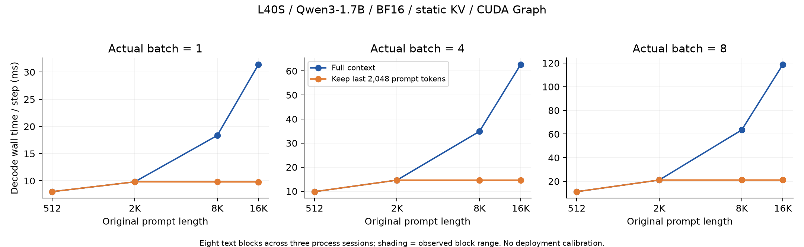
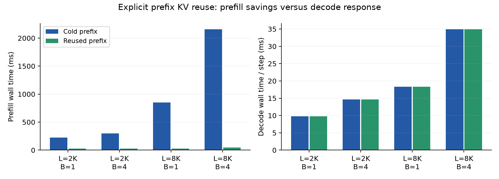
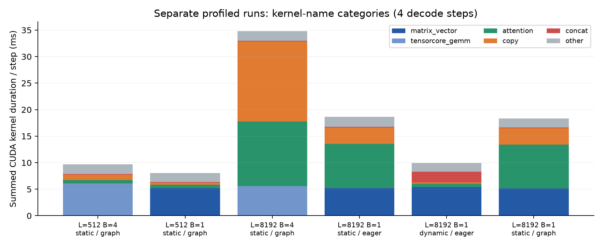
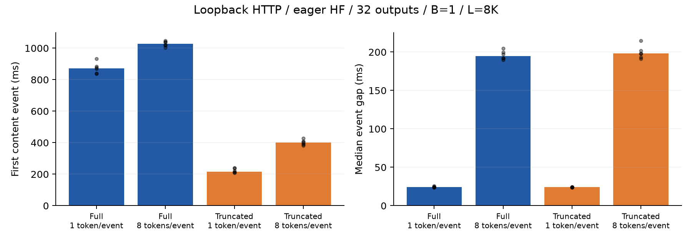

# L40S performance probes: context, prefix reuse, and kernel selection

19 October 2026 · Qwen3-1.7B · Single NVIDIA L40S · **Mechanism pilot; no calibrated remote detector.**

Completed **524 local measurements, 42 loopback HTTP requests, and six independent kernel traces**, plus 96 equivalent-SDPA controls. The main queue's stages totaled 33.35 minutes; peak allocated memory in the formal grid was 18.75 GiB. All planned measurement cells completed.

**Local context truncation and prefix reuse have different responses within the fixed implementation, but legitimate attention representations and kernel selection also produce large performance differences.** Calibration must cover the allowed implementations.

[Experiment design](../PERFORMANCE_PROBE_EXPERIMENTS.md) ·
[Summary and raw evidence](performance_probes_l40s_20261019/summary.json) ·
[Run queue](performance_probes_l40s_20261019/queue.json)

## Configuration and scope

- Main run source: 0d9e5407148db43fa2bfef57d13fd0b3d8c14465. Each subprocess records source hashes and Git status.
- Model: Qwen/Qwen3-1.7B, revision 70d244cc86ccca08cf5af4e1e306ecf908b1ad5e.
- BF16; PyTorch 2.8.0+cu128; Transformers 4.57.6; NVIDIA driver 595.91.07.
- Eight text-offset blocks across three fresh process sessions, drawn from the repository's public long-text fixture.
  These blocks share a corpus; they are not eight independent deployments or a broad prompt distribution.
  Stability across days remains untested.
- Main timings replay a fixed continuation. Twelve additional controls generate greedily.
  All use a fixed output budget, continuing after EOS; no top-p sampling is used.
- The main 128 output positions comprise one prefill output and 127 decode steps.
  P0 uses 16 outputs, HTTP uses 32, and profiles use five. Different budgets are not pooled.
- The main path uses preallocated StaticCache and CUDA Graph decode.
  Graph capture, cache allocation, and input preparation are outside the local prefill/decode timers
  and have separate recorded costs. These timings are not production request costs.
- CUDA event spans include host submission gaps; they are not pure kernel durations.
  Kernel durations come from separate profiler runs.
- Nsight Compute retries returned ERR_NVGPUCTRPERM. The host sets RmProfilingAdminOnly=1,
  and the container lacks CAP_SYS_ADMIN. DRAM traffic, L2 hit rate, and occupancy were not measured.
  Reported KV bytes describe tensor storage, not measured memory traffic.
  See the [permission log](performance_probes_l40s_20261019/counter_permission.log) and
  [permission environment](performance_probes_l40s_20261019/profiling_environment.json).

## P0: timing instrumentation and implementation controls

Four shapes, each with 20 paired events/plain technical repetitions, distributed across three processes.
The median paired decode-time ratio with per-step CUDA events is **1.0006×**.
These repetitions are not independent deployment samples.

The following unprofiled results use batch=1. Static versus dynamic cache also changes the mask,
GQA representation, and SDPA dispatch; this is not an isolated allocation-policy intervention.

| Initial context | KV cache | Execution | Median decode ms/step |
|---|---|---|---:|
| 512 | static | graph | 8.005 |
| 512 | static | eager | 23.766 |
| 512 | dynamic | eager | 20.785 |
| 8192 | static | graph | 18.335 |
| 8192 | static | eager | 23.963 |
| 8192 | dynamic | eager | 20.805 |

Static-cache eager/Graph controls have identical first-step logits and predicted tokens in 16/16 pairs. Dynamic/static argmax predictions agree at 2012/2048 positions (98.24%); these implementations are not bitwise equivalent. The latter is a candidate legitimate floating-point-path control, not a proof of whole-model numerical error bounds. The single-layer intervention below uses an FP32 reference.

## P1: context length × actual batch

L ∈ {512,2048,8192,16384}, B ∈ {1,4,8}, eight paired text blocks: 192 measurements.
The truncation condition removes all but the last 2,048 prompt tokens before prefill,
preserves absolute RoPE positions, and appends KV during decode. It does not evict tokens on every step.

| Original context | B | Full ms/step | Truncated ms/step | Median paired full/truncated |
|---|---:|---:|---:|---:|
| 8192 | 1 | 18.335 | 9.796 | 1.87× |
| 8192 | 4 | 34.887 | 14.614 | 2.39× |
| 8192 | 8 | 63.456 | 21.139 | 3.00× |
| 16384 | 1 | 31.400 | 9.794 | 3.21× |
| 16384 | 4 | 62.724 | 14.617 | 4.29× |
| 16384 | 8 | 118.883 | 21.136 | 5.63× |

All 48 negative-control pairs at L≤2048 have identical first-step logit hashes and predicted tokens. This checks that truncation is a no-op in that range; it does not require identical timings.



Shading shows the observed minimum–maximum across eight text blocks, not a confidence interval.
No detector threshold was trained and evaluated on this grid; no deployment FPR/TPR is reported.

## P4: legitimate prefix reuse

For L=2048/8192 and B=1/4, compare cache off, cold, hit, and input truncation: 128 measurements.
The reused prefix contains L−128 tokens; the hit arm processes only the final 128 prompt tokens.
Prefix priming happens outside the request timer, with its time recorded separately.
This is an explicit KV-reuse microbenchmark, not a vLLM APC benchmark. It excludes cache lookup,
eviction, and cross-request routing costs.

| L | B | Cold prefill ms | Hit prefill ms | Median paired cold/hit | Cold/hit decode ms/step |
|---|---:|---:|---:|---:|---:|
| 2048 | 1 | 222.95 | 25.97 | 8.47× | 9.795 / 9.794 |
| 2048 | 4 | 297.77 | 25.15 | 11.84× | 14.612 / 14.613 |
| 8192 | 1 | 849.17 | 26.78 | 31.68× | 18.336 / 18.338 |
| 8192 | 4 | 2155.63 | 46.81 | 46.04× | 34.889 / 34.887 |

All 32 three-arm controls pass: cache off/cold/hit have identical first-step logits and predicted tokens. Reuse primarily saves prefill work; the decode response to retained history must also be checked. Faster first content alone does not establish truncation.



## Hardware mechanism and kernel evidence

The device reports compute capability 8.9, 142 SMs, and 96 MB of L2 cache.
The [device inventory](performance_probes_l40s_20261019/device_inventory.json)
was recorded after the experiments; per-case GPU snapshots are in the measurement rows.

For this model, the persistent BF16 KV storage per token per sequence is
2 × 28 layers × 8 KV heads × 128 dimensions × 2 bytes = **114,688 bytes**.
At L=8192, B=1 the prompt KV alone occupies 0.875 GiB; at L=16384, B=8 it occupies 14 GiB.
The preallocated cache also reserves positions for decode. These sizes explain why changing
history length is a meaningful memory intervention, but do not establish how many bytes
actually reach DRAM.

The independent traces show B=1 linear layers primarily using GEMV kernels, while B=4
introduces BF16 WMMA Tensor Core GEMM kernels. Static-cache decode uses memory-efficient
attention with KV expansion/copying; dynamic-cache decode uses Flash Attention and cache concatenation.

In this Transformers version, an explicit mask disables the integration's native-GQA branch.
It expands eight KV heads to sixteen query heads before calling SDPA.
The persistent cache remains at eight heads; the expanded operands are temporary.
Consequently, two complete BF16 implementations can have different copying costs and attention kernels.
See the [pinned integration source](https://github.com/huggingface/transformers/blob/v4.57.6/src/transformers/integrations/sdpa_attention.py)
and [PyTorch SDPA documentation](https://docs.pytorch.org/docs/2.8/generated/torch.nn.functional.scaled_dot_product_attention.html).



Categories use actual kernel names. The copy category is not exclusively KV copying.
Summed durations are not bandwidth, occupancy, or critical-path percentages.
Each profile contains only four decode steps and is subject to profiler effects.
Its static cache is also 123 positions smaller than the main 128-output experiment.

## Causal control: equivalent SDPA representations

Keep Q/K/V identical and compare native GQA without a mask, explicit KV repetition without a mask,
and explicit repetition with an all-True Boolean mask. A single query can see every key in all three
arms, so their mathematical attention semantics are the same. There are eight random input blocks
per shape; each arm uses five timing groups of 100 graph replays. Repetition/copy costs are included.
Technical repetitions stabilize timing and are not independent input samples.

| B | KV length | Native GQA μs | Repeat/no-mask μs | Repeat/all-True μs | Masked/native ratio |
|---|---:|---:|---:|---:|---:|
| 1 | 512 | 8.27 | 14.54 | 29.77 | 3.60× |
| 1 | 8192 | 22.80 | 101.68 | 368.28 | 16.15× |
| 4 | 512 | 9.02 | 28.47 | 38.88 | 4.31× |
| 4 | 8192 | 186.51 | 981.84 | 957.50 | 5.13× |

All 96 controls pass the preset FP32 explicit-softmax reference check (atol=0.005, rtol=0.02). The maximum absolute error is **0.00117829**.

The B=4, L=8192 traces confirm that native GQA uses Flash Attention without the explicit KV-copy
kernels; repeated KV without a mask still uses Flash Attention but adds copying; adding the mask
switches to memory-efficient attention. At this shape the two repeated-KV arms have similar total
times, so a mask does not uniformly make attention slower. Representation and dispatch must be
considered together.

These repeated accesses use the same Q/K/V and have cache-warmth effects.
Their absolute times cannot be extrapolated directly to a multi-layer LLM.
This control supports implementation-dependent performance differences; it does not certify
hardware identity, model precision, or floating-point equivalence on all inputs.

The first supplementary attempt failed before any timing rows were written: it checked the captured
graph's output before replaying the graph. The correction adds one replay before validation;
the error tolerance was unchanged. The failed plan, source, and explanation are
[preserved separately](performance_probes_l40s_20261019/sdpa_failed_capture_check/failure.json).
All 96 reported measurements come from the corrected run.

## HTTP: buffering and host overhead change the observable signal

Three fresh server processes, each queried serially by a separate CPU client; C=1.
B is an explicitly selected server batch and is not concurrent-request count.
Transport is loopback NDJSON token-ID frames, not a public text API.
Requests select a fixture; they do not transmit/tokenize the full long prompt.
Raw events retain token IDs, positions, and client monotonic timestamps.

Results for L=8192, B=1; six requests per condition:

| Condition | Tokens/event | First content event ms | Median event gap ms | Events/request |
|---|---:|---:|---:|---:|
| full | 1 | 872.66 | 24.21 | 32 |
| full | 8 | 1028.22 | 194.60 | 4 |
| truncate | 1 | 216.68 | 24.04 | 32 |
| truncate | 8 | 400.20 | 198.01 | 4 |



Client token sequences match server records at every position for all 42 requests. Combining eight tokens per frame changes first-content time and event gaps; a received event is not necessarily a single token.

There is also a negative result: with one token per event, full and truncated contexts both have
roughly 24 ms event gaps in this eager server. The clear local CUDA Graph decode separation is
largely hidden by the eager execution/host path. A local mechanism signal does not automatically
survive the serving stack. Prefix-reuse separation was measured locally, not validated as an HTTP detector.

This experiment does not cover public-network queues, production dynamic batching, cross-region
networks, or adaptive providers. Server logs are diagnostic evidence, not hidden client-detector features.

## Conclusions and remaining work

This pilot connects controlled cache/shape changes to observed kernel paths and timing responses. It also exposes two limitations: legitimate implementation changes can dominate the signal, and host execution can hide it from the client. The next experiment should fix a production serving engine, measure the allowed kernel/cache conditions, and then use separate calibration and evaluation sessions. These exploratory data do not establish a universal detection rate.

Weight/KV precision probes, cross-hardware transfer, capacity frontiers, and full adaptive evasion
remain future work in this performance-probe series. These BF16 results are not quantization-detection results.

## Reproduction and verification

Use the recorded dependencies, pinned model snapshot, and an idle L40S. Reproduce the main run in a separate checkout; its source must be clean and the output directory absent. The recorded scripts default to the prepared model cache under /workspace/.cache/huggingface.

```sh
git checkout 0d9e5407148db43fa2bfef57d13fd0b3d8c14465
.venv/bin/python -m experiments.run_performance_pilot --output runs/performance-reproduction
```

On the branch containing this archive, verify the saved results without a GPU or model:

```sh
(cd docs/results/performance_probes_l40s_20261019 && sha256sum -c SHA256SUMS)
python -m experiments.analyze_performance_probes \
  docs/results/performance_probes_l40s_20261019 --output /tmp/performance-recomputed.json
```

Run the supplementary control separately on an idle GPU:

```sh
OMP_NUM_THREADS=1 OPENBLAS_NUM_THREADS=1 python -m experiments.exp_sdpa_representation_gpu \
  --output runs/sdpa-reproduction
```

Regenerate figures (requires matplotlib) and the report into scratch paths:

```sh
python -m experiments.plot_performance_probes docs/results/performance_probes_l40s_20261019 \
  --output /tmp/performance-figures
python docs/results/performance_probes_l40s_20261019/render_report.py \
  docs/results/performance_probes_l40s_20261019 \
  --template docs/results/performance_probes_l40s_20261019/report_template.md \
  --output /tmp/performance-report.md
```

The archive retains raw records, plans, manifests, package lists, logs, compressed CUDA traces,
source snapshots, the model configuration, figures, and supplementary measurements.
Model weights and access credentials are not included.
