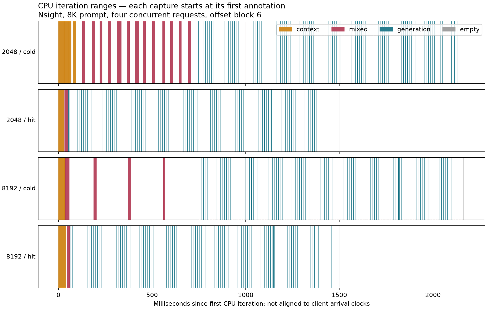
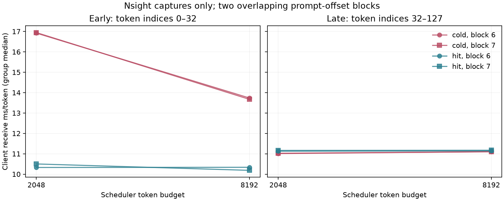

# Scheduler-budget diagnostics on L40S

19 October 2026.

The cache-cold captures directly show generation and unfinished context work in the same iterations. At budgets 2,048 and 8,192, mixed-iteration counts are respectively **13.00 [13.00, 13.00]** and **4.00 [4.00, 4.00]**. Early receive intervals are 16.93 [16.92, 16.95] versus 13.70 [13.67, 13.74] ms/token; late intervals are 11.02 [11.01, 11.02] versus 11.10 [11.10, 11.10] ms/token. These Nsight measurements support a scheduling contribution to the early-stream effect on this host, with the configuration and sampling limitations below.

This follow-up records context/generation iteration annotations and GPU launch correlations while changing the vLLM scheduler token budget from 2,048 to 8,192. It tests the scheduling explanation for the early-stream effect in the previous serving pilot. These are descriptive mechanism measurements, not a calibrated verifier.

## Protocol and validation

- 26/26 fresh-server runs verified; 98 measured requests and 12,544 generated tokens. Priming and warm-up requests are excluded.
- Qwen3-1.7B revision `70d244cc86ccca08cf5af4e1e306ecf908b1ad5e`; BF16 weights/KV; pinned vLLM 0.22.0 and PyTorch 2.11.0+cu130; one L40S; FLASH_ATTN; 12 GiB KV cache; chunked prefill; asynchronous scheduling.
- Primary grid: Nsight × two budgets × two offset blocks (6, 7) × full, truncated, cache-cold, and cache-hit arms. 8,192 input tokens, four concurrent requests, 128 output tokens per request. Truncation retains the final 2,048 tokens and restarts positions.
- Loopback streaming completions use exact token-ID prompts, greedy generation, and ignore-EOS. Receive-time clocks start after sending the request. Cache-hit responses must report exactly 8,064 cached tokens; every other measured response must report zero.
- Auxiliary controls: four unprofiled runs, two PyTorch runs, two single-request runs, and two eager runs. Each auxiliary cell has one offset block. Optimized mode includes compilation and CUDA Graphs; eager disables both.
- `graph_off` and `graph_on` both use optimized execution; their suffix refers to prefix caching off/on. `eager_off` uses eager execution with prefix caching off.
- A seeded shuffled plan and measurement-source snapshots were saved before launch. Each run holds the exclusive host lock, warms the server, captures only the measurement group, shuts down its own server, and validates before the next run.
- Offline validation additionally requires the annotations to account for every uncached prompt token and every post-first generation token, with no iteration exceeding its configured scheduler token budget.
- Early arrivals use indices 0–32 (32 intervals); late arrivals use 32–127 (95 intervals), fixed from the prior study before this campaign. Coalesced tokens retain the same receive timestamp. Client concurrency is not the scheduler batch size.
- New blocks are overlapping windows of the same public corpus, not independent corpora. There are two group observations per primary cell; concurrent requests are not treated as independent replicates. Brackets below are observed ranges, not confidence intervals.
- Lightweight CPU-side inspection and analysis occurred during the campaign; no additional GPU workload was launched. Profiled arrivals include collector overhead and remain separate from unprofiled results.

## Primary scheduling and arrival measurements

Cells show the median [minimum, maximum] across two block-level group summaries. Mixed iterations have both context requests (no generated token yet) and generation requests in the vLLM annotation.

| Budget | Configuration / arm | Mixed iterations | Context iterations after generation begins | Early ms/token | Late ms/token | TTFT ms |
|---:|---|---:|---:|---:|---:|---:|
| 2048 | graph_off / full | 13.00 [13.00, 13.00] | 13.00 [13.00, 13.00] | 16.93 [16.88, 16.98] | 11.00 [10.99, 11.02] | 530.73 [528.70, 532.76] |
| 2048 | graph_off / truncate | 4.00 [4.00, 4.00] | 4.00 [4.00, 4.00] | 7.79 [7.79, 7.79] | 7.31 [7.31, 7.32] | 151.98 [151.62, 152.35] |
| 2048 | graph_on / cold | 13.00 [13.00, 13.00] | 13.00 [13.00, 13.00] | 16.93 [16.92, 16.95] | 11.02 [11.01, 11.02] | 544.29 [542.70, 545.88] |
| 2048 | graph_on / hit | 1.00 [1.00, 1.00] | 1.00 [1.00, 1.00] | 10.41 [10.33, 10.50] | 11.14 [11.13, 11.16] | 94.44 [87.60, 101.27] |
| 8192 | graph_off / full | 4.00 [4.00, 4.00] | 4.00 [4.00, 4.00] | 13.73 [13.72, 13.74] | 11.09 [11.09, 11.10] | 676.79 [667.73, 685.85] |
| 8192 | graph_off / truncate | 1.00 [1.00, 1.00] | 1.00 [1.00, 1.00] | 8.14 [8.04, 8.25] | 7.33 [7.33, 7.33] | 139.17 [137.72, 140.62] |
| 8192 | graph_on / cold | 4.00 [4.00, 4.00] | 4.00 [4.00, 4.00] | 13.70 [13.67, 13.74] | 11.10 [11.10, 11.10] | 687.53 [683.64, 691.42] |
| 8192 | graph_on / hit | 0.50 [0.00, 1.00] | 0.50 [0.00, 1.00] | 10.26 [10.19, 10.34] | 11.16 [11.14, 11.17] | 112.35 [110.89, 113.81] |





## Paired cold/hit comparisons

Ratios pair the same offset block within each tool and budget, then summarize across blocks. Tools are never pooled. Single-block controls describe one group per condition, not a precise overhead estimate.

| Tool | Budget | Blocks | Early cold/hit | Late cold/hit | TTFT cold/hit |
|---|---:|---:|---:|---:|---:|
| nsys | 2048 | 2 | 1.63 [1.61, 1.64] | 0.99 [0.99, 0.99] | 5.80 [5.36, 6.23] |
| nsys | 8192 | 2 | 1.34 [1.33, 1.34] | 0.99 [0.99, 1.00] | 6.12 [6.01, 6.24] |
| none | 2048 | 1 | 1.65 | 0.99 | 5.58 |
| none | 8192 | 1 | 1.34 | 0.99 | 8.90 |
| torch | 2048 | 1 | 1.65 | 0.99 | 5.36 |

## Auxiliary profiler, concurrency, and execution controls

| Tool | Budget | Configuration / arm | C | Mixed iterations | Early ms/token | Late ms/token |
|---|---:|---|---:|---:|---:|---:|
| none | 2048 | graph_on / cold | 4 | not captured | 16.88 | 10.95 |
| none | 2048 | graph_on / hit | 4 | not captured | 10.25 | 11.07 |
| none | 8192 | graph_on / cold | 4 | not captured | 13.68 | 11.03 |
| none | 8192 | graph_on / hit | 4 | not captured | 10.20 | 11.10 |
| nsys | 2048 | eager_off / full | 4 | 13 | 24.66 | 20.26 |
| nsys | 2048 | eager_off / truncate | 4 | 4 | 20.86 | 20.09 |
| nsys | 2048 | graph_on / cold | 1 | 0 | 6.76 | 7.03 |
| nsys | 2048 | graph_on / hit | 1 | 0 | 6.72 | 6.99 |
| torch | 2048 | graph_on / cold | 4 | 13 | 17.03 | 11.00 |
| torch | 2048 | graph_on / hit | 4 | 1 | 10.30 | 11.12 |

## Output agreement across scheduler budgets

Paired Nsight requests use identical inputs at the two budgets. Output disagreement during free generation is recorded rather than treated as a model-identity failure.

| Configuration / arm | Identical 128-token sequences / pairs | Matching token positions / total |
|---|---:|---:|
| graph_off / full | 1/8 | 393/1024 |
| graph_off / truncate | 4/8 | 705/1024 |
| graph_on / cold | 3/8 | 673/1024 |
| graph_on / hit | 5/8 | 774/1024 |

## Trace interpretation and limits

The traces contain 1,190,255 CUDA kernel events, of which 1,152,937 (96.86%) are attributed through runtime launch correlation to a containing CPU iteration on the launch thread. The remaining 37,318 events are retained as unattributed; they are not assigned by temporal overlap.

All 26 servers exited with return code zero and without forced termination. 26 logs contain a Python resource-tracker semaphore warning at shutdown; the warnings are retained with the raw logs.

The iteration timeline shows CPU ranges, not GPU duration. The machine-readable summary separately records kernel duration sums, interval unions, and first/last GPU times for every correlated iteration. CPU ranges do not synchronize asynchronous GPU work. Projected GPU annotations in PyTorch are not counted as extra iterations. Empty scheduler ranges are retained.

The context/generation label semantics are preserved in `installed_source/vllm/v1/utils.py` and `installed_source/vllm/v1/worker/gpu_worker.py`. A context request has not yet generated a token; an extended chunked-prefill segment remains in that category.

Client receive clocks are not aligned to the profiler clock. These data show group-level scheduling and arrival associations, not which kernel delayed a particular request. Free generation can diverge across schedules, and increasing the token budget also changes the compiler range and execution shapes. This is a serving-configuration intervention, not a scheduler-only hardware microbenchmark.

Two overlapping text offsets, one GPU, and one campaign do not establish deployment false-positive rates, cross-hardware transfer, or independent generalization. DRAM, L2, and occupancy counters were not collected. A calibrated detector needs a separately frozen statistic and independent calibration/test inputs.

## Reproduction

Run from the repository root with the pinned environments and cached model, on an idle GPU, using a new output directory:

```sh
.venv/bin/python -u -m experiments.run_scheduling_campaign --output runs/scheduling-reproduction
.venv/bin/python -m experiments.analyze_scheduling_campaign runs/scheduling-reproduction --output /tmp/scheduling-summary.json
```

Offline archive verification and figure/report regeneration:

```sh
(cd docs/results/scheduling_l40s_20261019 && sha256sum -c SHA256SUMS)
.venv/bin/python -m experiments.analyze_scheduling_campaign docs/results/scheduling_l40s_20261019 --output /tmp/scheduling-summary.json
.venv/bin/python -m experiments.report_scheduling_campaign /tmp/scheduling-summary.json --output /tmp/scheduling-report.md --figures /tmp/scheduling-figures
```

The public archive contains the frozen plan, source snapshots, verified summaries, raw responses, logs, PyTorch traces, and sanitized Nsight SQLite exports. Environment metadata was removed from the SQLite exports; proprietary `.nsys-rep` originals remain in ignored local storage. `PUBLICATION.json` records original/published hashes and confirms unchanged kernel, runtime, and NVTX measurement tables. Future profiling/export processes receive an allowlisted environment and use `--discard-environment=true`, but CPU-only smoke tests still found credential strings in raw reports with these measures. Publication therefore always sanitizes exported metadata and keeps original binaries private. Saved measurement sources preserve the original commands.

SHA256SUMS covers every published file other than the checksum file itself. No model weights are included.
