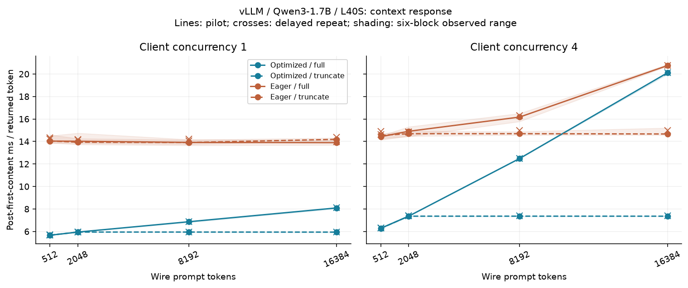
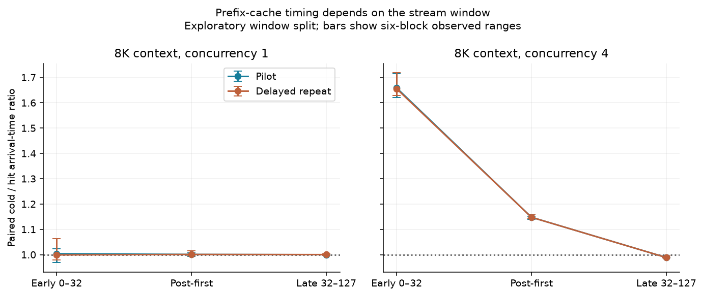

# vLLM serving controls and delayed replication on L40S

19 October 2026. Follow-up to the [local performance probes](performance_probes_l40s_20261019.md).

The context-length timing signal survives optimized vLLM serving on this host, but its size depends on execution mode, concurrency, and the part of the stream being measured. In the first pilot, the 16K full/truncated post-first-content ratio is 1.36× at client concurrency 1 and 2.73× at concurrency 4. The tables below retain the delayed repeat separately. Prefix caching changes first-content latency and the early concurrent stream, so neither is a direct measure of retained-context decode cost.

These are descriptive mechanism results. No classifier, detection threshold, deployment false-positive rate, or attack-power estimate was fitted.

## Protocol and provenance

- Qwen3-1.7B, revision `70d244cc86ccca08cf5af4e1e306ecf908b1ad5e`, BF16 weights and KV; one NVIDIA L40S, driver 595.91.07.
- Pinned vLLM 0.22.0, Transformers 4.57.6, PyTorch 2.11.0+cu130, Python 3.12. Exact package lists and model configuration accompany both runs.
- FLASH_ATTN confirmed in all server logs. Optimized runs confirm FULL_AND_PIECEWISE CUDA Graphs; eager disables both torch.compile and CUDA Graphs. This does not isolate graphs alone.
- Configuration names: `graph_off` and `graph_on` both use compiler/graph optimizations, with prefix caching off/on respectively. `eager_off` uses eager execution with prefix caching off.
- 12 GiB KV budget, 16-token blocks, 2,048-token scheduler budget, maximum eight active sequences. Chunked prefill enabled; one server process group at a time under the host lock.
- Loopback streaming completions with token-ID prompts, greedy generation, 128 output tokens, and ignore-EOS. Each event may carry multiple tokens. Client clocks start after sending the request; connections and prefix priming are excluded.
- Truncation keeps the last 2,048 input tokens and restarts positions at zero. The wire prompt is unchanged. L≤2,048 is a no-op control.
- Each phase: nine fresh server runs, six paired text-offset blocks, 240 groups, 600 measured requests and 76,800 returned tokens; 60 priming and 45 warm-up requests excluded from measured summaries.
- The delayed repeat began 18.25 minutes after the pilot finished. It reuses the exact prompts, seeds, configuration rotation, and within-run order. It tests temporal repeatability, not generalization to new prompts or deployments.
- Lightweight CPU-side analysis and documentation work continued on the host during the repeat; no additional GPU workload was launched. Host-load variation is part of this temporal comparison, not an independently controlled factor.
- Both measurement phases used clean source commit `762acaa3e2b96d2514e5abe2d95a0c1eeb93e7b1`. Analysis and archival code was added afterward. Maximum **sampled** GPU memory across group-boundary snapshots was 16,449 MiB; this is not an instantaneous peak measurement.

| Phase | Start UTC | Finish UTC |
|---|---|---|
| pilot | 2026-10-19T02:01:36Z | 2026-10-19T02:13:02Z |
| delayed_repeat | 2026-10-19T02:31:17Z | 2026-10-19T02:42:43Z |

The [frozen measurement protocol](vllm_serving_l40s_20261019/measurement_source/docs/VLLM_SERVING_EXPERIMENT.md) and per-run plans, commands, environment overrides, package versions, raw SSE frames, GPU snapshots, logs, metrics, and source hashes are archived. The earlier local study used a different software stack, position policy, and frozen continuation; absolute timings across studies are not a controlled engine-only comparison.

## Context response

Rates below are medians of group medians. A group contains one or four concurrent requests. Ratios are computed within each matched text block first; brackets show the observed minimum and maximum of six block ratios, not confidence intervals. C is client concurrency, not the internal scheduler batch size.

| Mode | L | C | Pilot full / truncated ms per token | Pilot ratio [range] | Repeat ratio [range] |
|---|---:|---:|---:|---:|---:|
| graph_off | 8192 | 1 | 6.866 / 5.949 | 1.155 [1.146, 1.157] | 1.156 [1.149, 1.159] |
| graph_off | 8192 | 4 | 12.487 / 7.361 | 1.698 [1.694, 1.700] | 1.692 [1.687, 1.700] |
| graph_off | 16384 | 1 | 8.095 / 5.944 | 1.363 [1.349, 1.369] | 1.364 [1.355, 1.371] |
| graph_off | 16384 | 4 | 20.107 / 7.359 | 2.731 [2.716, 2.740] | 2.722 [2.711, 2.725] |
| eager_off | 8192 | 1 | 13.919 / 13.911 | 1.000 [0.981, 1.008] | 0.992 [0.982, 1.003] |
| eager_off | 8192 | 4 | 16.170 / 14.694 | 1.105 [1.073, 1.123] | 1.101 [1.061, 1.117] |
| eager_off | 16384 | 1 | 13.896 / 14.191 | 0.984 [0.959, 0.985] | 0.998 [0.961, 1.026] |
| eager_off | 16384 | 4 | 20.751 / 14.667 | 1.413 [1.372, 1.421] | 1.388 [1.348, 1.413] |

Optimized serving exposes a context response. In eager mode, the concurrency-1 full/truncated ratios remain close to one even at long context. This is a negative result for interpreting a small decode-time difference as evidence that the provider retained less context.



## Prefix reuse and stream position

All off/cold requests return zero cached tokens. Every hit returns exactly L−128 cached tokens: 1,920 at L=2,048 and 8,064 at L=8,192. Priming requests are saved separately. A successful reset response alone is not used as proof of eviction.

| L | C | Pilot cold / hit TTFT ms | Pilot TTFT ratio [range] | Repeat TTFT ratio [range] |
|---|---:|---:|---:|---:|
| 2048 | 1 | 43.90 / 19.98 | 2.188 [1.711, 2.505] | 2.019 [1.829, 2.131] |
| 2048 | 4 | 145.00 / 50.53 | 2.885 [2.509, 3.992] | 3.242 [2.697, 3.974] |
| 8192 | 1 | 198.36 / 34.10 | 5.773 [5.477, 6.177] | 5.874 [4.148, 6.592] |
| 8192 | 4 | 543.64 / 100.38 | 5.389 [4.903, 6.851] | 5.507 [4.678, 6.660] |

After inspecting the first pilot, we split arrival times at token index 32: early spans indices 0–32 (32 intervals), and late spans 32–127 (95 intervals). This split is exploratory and was not part of the original frozen protocol. It is applied unchanged to the delayed repeat. Coalesced tokens retain their common event timestamp; these are receive-time diagnostics, not GPU-step measurements or a certified steady-state window.

| 8K cache control | C | Early cold/hit ratio | Whole post-first ratio | Late cold/hit ratio |
|---|---:|---:|---:|---:|
| pilot | 1 | 1.003 [0.968, 1.023] | 1.001 [0.992, 1.006] | 1.000 [0.999, 1.001] |
| pilot | 4 | 1.658 [1.621, 1.716] | 1.148 [1.140, 1.150] | 0.989 [0.988, 0.990] |
| delayed_repeat | 1 | 0.999 [0.980, 1.063] | 1.001 [0.996, 1.014] | 1.000 [0.997, 1.003] |
| delayed_repeat | 4 | 1.655 [1.629, 1.718] | 1.147 [1.144, 1.158] | 0.988 [0.988, 0.996] |

The concurrency-4 cache benefit is concentrated near the beginning of the stream; the late window is much closer to parity. This is consistent with overlapping prefill/scheduling work affecting early arrivals, but no per-step scheduler trace was collected to establish the cause. The full-context/truncation response also becomes smaller in the late concurrent window:

| 16K, C=4 | Phase | Whole full/truncated ratio | Late full/truncated ratio |
|---|---|---:|---:|
| graph_off | pilot | 2.731 [2.716, 2.740] | 2.179 [2.175, 2.180] |
| graph_off | delayed_repeat | 2.722 [2.711, 2.725] | 2.174 [2.173, 2.176] |
| eager_off | pilot | 1.413 [1.372, 1.421] | 1.121 [1.094, 1.142] |
| eager_off | delayed_repeat | 1.388 [1.348, 1.413] | 1.102 [1.074, 1.128] |



## Temporal repeatability and output controls

Each cell below first pairs repeat/pilot rates by block. The table then reports the median and range of those cell medians across all lengths, concurrency levels, and arms within each configuration. It does not pool concurrent requests as independent deployments.

| Configuration | Cells | Repeat/pilot post-first ratio: median [range of cell medians] |
|---|---:|---:|
| graph_off | 16 | 1.003 [1.000, 1.005] |
| graph_on | 8 | 1.004 [1.000, 1.005] |
| eager_off | 16 | 1.011 [1.000, 1.026] |

Greedy output equality is measured, not assumed. Even no-op truncation and legitimate cache controls can diverge during free generation. A small numerical difference at one position can alter the remaining continuation; sequence disagreement is not itself evidence of a different model or malicious inference.

| Phase | Control | Identical 128-token sequences / pairs | Matching token positions / positions |
|---|---|---:|---:|
| pilot | noop_truncation | 74/120 | 11577/15360 |
| pilot | cold_vs_hit | 19/60 | 3990/7680 |
| pilot | cache_off_vs_cold | 35/60 | 5722/7680 |
| delayed_repeat | noop_truncation | 69/120 | 11020/15360 |
| delayed_repeat | cold_vs_hit | 22/60 | 4402/7680 |
| delayed_repeat | cache_off_vs_cold | 35/60 | 5585/7680 |
| repeat vs pilot | graph_off | 156/240 | 23519/30720 |
| repeat vs pilot | graph_on | 69/120 | 10804/15360 |
| repeat vs pilot | eager_off | 141/240 | 22432/30720 |

No-op truncation agreement separates clearly by concurrency:

| Phase | C | Identical sequences / no-op pairs (both execution modes) |
|---|---:|---:|
| pilot | 1 | 24/24 |
| pilot | 4 | 50/96 |
| delayed_repeat | 1 | 24/24 |
| delayed_repeat | 4 | 45/96 |

The pilot and repeat contain 67 and 98 coalesced tokens respectively. Post-first normalization excludes every token in the first content event, not just one token. Raw frames and token IDs are retained so denominators can be recomputed.

## Failures, limits, and next experiment

The first preflight failed during server argument parsing. The second reached serving but failed because the prefix-cache reset route was unavailable. The third passed after correcting the arguments and enabling development routes consistently on the loopback-only servers. All three attempts and their source snapshots are retained; none contributes to the 1,200 formal measured requests.

The repeat strengthens a same-host timing observation. It does not provide independent corpora, different GPUs, public-network queues, unknown tenant traffic, or deployment calibration. Free generation is not frozen-token replay. No DRAM traffic, L2 hit-rate, occupancy, or hardware-identity claim follows from these data.

The next experiment should capture per-step scheduler/prefill diagnostics in a separate profiling run, then freeze an arrival-window statistic before collecting independent prompt and session blocks for calibration and evaluation. Legitimate eager execution, caching, and concurrency belong in the honest-condition envelope. Thresholds should not be fitted to this exploratory pilot and reported as deployment accuracy.

## Offline verification and reproduction

From the repository root, with the normal project environment (no model or GPU needed for analysis):

```sh
(cd docs/results/vllm_serving_l40s_20261019 && sha256sum -c SHA256SUMS)
python -m experiments.analyze_vllm_serving_campaign \
  docs/results/vllm_serving_l40s_20261019 --output /tmp/vllm-serving-summary.json
python -m experiments.plot_vllm_serving \
  docs/results/vllm_serving_l40s_20261019 --output /tmp/vllm-serving-figures
python -m experiments.render_vllm_serving_report \
  docs/results/vllm_serving_l40s_20261019 --output /tmp/vllm-serving-report.md
```

The campaign validator checks all 18 expected process runs, source snapshots, file hashes, plans, exact fixture payloads, cache counts, output budgets, raw-stream summaries, auxiliary requests, effective backend/graph logs, and matched repetition inputs. The archive includes the frozen measurement helper and analysis sources, model configuration, public fixture, and dependency versions; model weights and credentials are excluded.

To repeat GPU measurements, use a separate clean checkout at the measurement commit and the recorded pinned environment/model cache. Each destination must be absent. Run one command at a time on the idle L40S:

```sh
git checkout 762acaa3e2b96d2514e5abe2d95a0c1eeb93e7b1
OMP_NUM_THREADS=1 OPENBLAS_NUM_THREADS=1 .venv/bin/python -m experiments.exp_vllm_serving \
  --suite pilot --output runs/vllm-reproduction/pilot
# After the first process exits, repeat into a new path and retain its timestamps.
OMP_NUM_THREADS=1 OPENBLAS_NUM_THREADS=1 .venv/bin/python -m experiments.exp_vllm_serving \
  --suite pilot --output runs/vllm-reproduction/delayed_repeat
```
